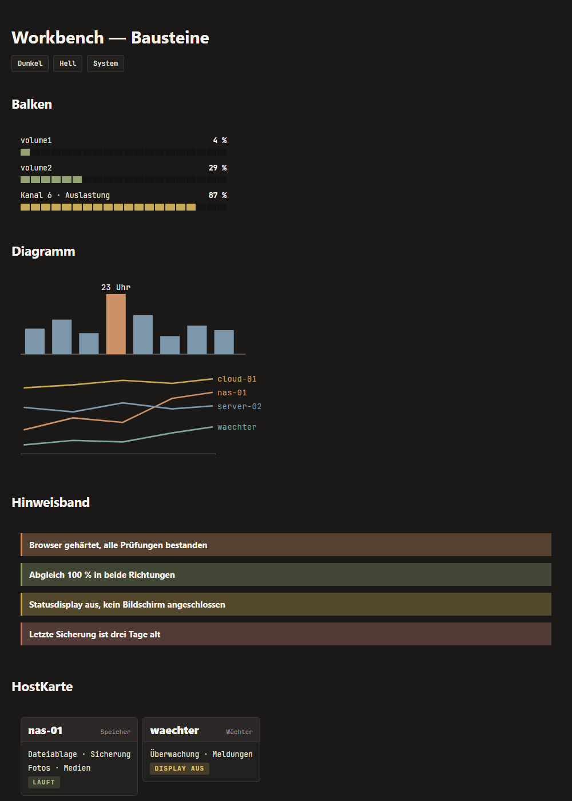

# Workbench

**English** · [Deutsch](README.de.md)

**A personal design system in warm, muted colours for the terminal, the web, office documents and Obsidian.**

The name comes from the operating system of the **Amiga 500**. Workbench looks like an old instrument panel: a warm dark ground, a single loud accent in amber, and every other tone earthy and restrained.



Version **1.0** · 9 October 2026

---

## The three rules

1. **The ground is warm.** `#1a1918`, never a neutral `#1e1e1e`.
2. **One loud accent.** Only amber (*Bernstein*) `#cc9166` may be loud. Everything else steps back.
3. **One family.** Muted and earthy. No neon, no pure red, green or blue.

And one more: **colour never decides on its own.** Every status indicator carries a word, because sage and rosé are hard to tell apart for people with red-green colour blindness.

## The palette

Token names are German. They are listed here with their English meaning.

| Token | Dark | Light | Meaning |
|---|---|---|---|
| `grund` (ground) | `#1a1918` | `#efeae1` | page background |
| `panel` | `#232120` | `#f7f3ec` | cards, surfaces |
| `linie` (line) | `#3a3634` | `#d3cabb` | borders, dividers |
| `schrift` (text) | `#e9e3d8` | `#2a2724` | body text |
| `gedaempft` (muted) | `#a49c90` | `#6a6258` | secondary text, labels |
| `fett` (bold) | `#f5f1eb` | `#171512` | bold text, text on markers |
| **`bernstein`** (amber) | `#cc9166` | `#975b34` | the one accent, what matters most |
| `salbei` (sage) | `#93a373` | `#5e7040` | good, done |
| `stahl` (steel) | `#7d97ab` | `#456579` | neutral, data, links |
| `gold` | `#c7a854` | `#7e6820` | caution, estimated |
| `rose` (rosé) | `#c07f73` | `#9c4d40` | critical, error |
| `petrol` | `#7fa79f` | `#4e716a` | secondary tone, third data series |
| `malve` (mauve) | `#b1899b` | `#8c5c72` | secondary tone, code |

All 60 tokens live in [`tokens/tokens.json`](tokens/tokens.json). That includes text markers (25 %), subtle markers (14 %), banners (33 %) and status tones. Every token has a usage note with contrast ratios. The notes and the documentation in `docs/` are written in German.

## Type, grid, shapes

- **Atkinson Hyperlegible Next** for headings and body text, designed for legibility (I, l and 1 are clearly distinct).
- **JetBrains Mono** for code, numbers and labels.
- **4 px grid:** 4 · 8 · 12 · 16 · 24 · 32 · 48 px.
- **Corners:** 6 px for cards, 3 px for markers and pills.
- **Depth** comes from surface layers instead of shadows. Only floating elements get a shadow.
- **Charts:** a single series in steel, with the value that matters in amber. Multiple series in amber · steel · petrol · gold, at most four, labelled directly.

## Contents

```
tokens/tokens.json                    all tokens, dark and light (the source)
css/workbench.css                     CSS custom properties, generated from the tokens
components/workbench-components.css   components: banner, text marker, status pill,
                                      host card, bar, measurement table, chart, menu
components/README.md                  guide for each component (German)
examples/bausteine.html               every component on one page, dark and light
docs/                                 basics, office, Obsidian, terminal, Claude Code (German)
assets/                               "wb" monogram (dark, light, favicon)
obsidian/                             Obsidian theme "Workbench" (GPL-3.0, see below)
terminal/                             Windows Terminal, PowerShell profile, wb.ps1, wb.sh,
                                      Claude Code theme
```

## Usage

### On the web

```html
<link rel="stylesheet" href="css/workbench.css">
<link rel="stylesheet" href="components/workbench-components.css">

<div class="wb-band">Key message across the full width</div>
<span class="wb-status wb-status--gut">free</span>
<span class="wb-mark">Key result</span>
```

Dark is the default. Light switches on through `prefers-color-scheme`, or explicitly with `data-theme="light"` on the `<html>` element.

### Obsidian

Copy the folder `obsidian/Workbench/` to `<vault>/.obsidian/themes/`, then pick "Workbench" under Settings → Appearance → Themes. The five main folders are coloured by name (`00 KONTEXT` to `40 RESOURCEN`). For other names, edit `obsidian_theme_bauen.py` and rebuild:

```
python obsidian/obsidian_theme_bauen.py "<path>/Soft Paper/theme.css" "<vault>/.obsidian/themes/Workbench"
```

### Windows Terminal, PowerShell, Claude Code

Templates live in [`terminal/`](terminal/). [`docs/terminal-und-powershell.md`](docs/terminal-und-powershell.md) describes the colour scheme, prompt, file colours and colour helpers. [`docs/claude-code.md`](docs/claude-code.md) covers the Claude Code theme.

### Word, Excel, PowerPoint

Theme colours, paragraph styles and slide layout are in [`docs/office.md`](docs/office.md). The values also apply to OnlyOffice and LibreOffice.

## Licence

- **Everything except `obsidian/`:** [MIT](LICENSE).
- **`obsidian/`:** [GPL-3.0](obsidian/LICENSE). The theme is derived from [Soft Paper](https://github.com/nickmilo/soft-paper) by Nick Milo, which builds on [AnuPpuccin](https://github.com/AnubisNekhet/AnuPpuccin) by Anubis. Both are licensed under GPL-3.0.
- **Fonts** are not included. Atkinson Hyperlegible Next and JetBrains Mono are licensed under the SIL Open Font License 1.1.
