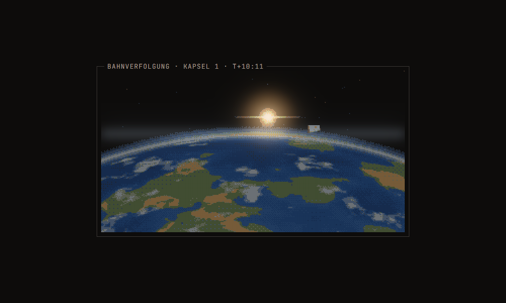

# Textgrafik im Stil von Third Bloc

Bilder aus Zeichen statt aus Pixeln, nach dem Vorbild des Spiels *Third Bloc*: jeder Bildpunkt ein kleines
Zeichen mit Fuge, wenige Töne je Material mit geordnetem Raster, dunkle Flächen als Körnung, Licht, das über
die Zeichen hinaus leuchtet. `textgrafik.js` ist ein Baustein für den Browser ohne Abhängigkeiten.
`SKILL.md` beschreibt Regeln und Gebrauch und ist zugleich ein Skill für Claude Code.



## Einrichten

```
bash textgrafik/install.sh                         # Linux, macOS, Git Bash
pwsh -File textgrafik/Install-Textgrafik.ps1       # Windows
```

Beide kopieren Baustein, Anleitung, Prüfskript und Beispiel nach `~/.claude/skills/textgrafik`. Für eine
Webseite genügt `textgrafik.js` allein.

## Beispiel

`beispiel/erdrand.html` im Browser öffnen: eine gemalte Szene (Kugel mit räumlichem Rauschen, Atmosphäre,
Sonne in der Lichtebene), die der Baustein in Zeichen umsetzt. Die Schrift darüber bleibt scharf.

## Die fünf Regeln

1. Erst mit Licht malen, dann rastern.
2. Wenige Töne je Material, dazwischen ein 4×4-Bayer-Raster.
3. Jeder Bildpunkt ein Zeichen mit Fuge.
4. Dunkles wird Körnung, nicht mattes Grau.
5. Was leuchtet, kommt in eine eigene Lichtebene.

## Was ich beim Testen gelernt habe

- **Auf hellem Grund** muss die Fuge dunkler sein als das Zeichen, sonst wird alles blass.
- **Die automatische Palette** taugt für Logos mit großen Farbflächen. In dunklen Szenen mit kleinen
  farbigen Dingen gehen die Farben verloren; dort Tonleitern je Material vorgeben.
- **Körnung** passt zu Szenen auf Schwarz, nicht zu Szenen, die von gedämpften dunklen Flächen leben.
- **Prüfen:** `pruefen.sh seite.html bild.png` fotografiert eine Seite im kopflosen Chrome ab. Erst ansehen,
  dann zeigen.
